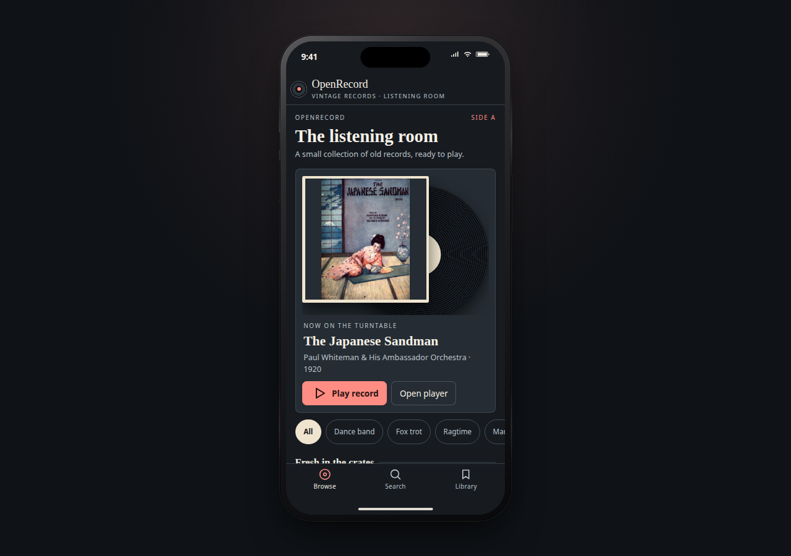
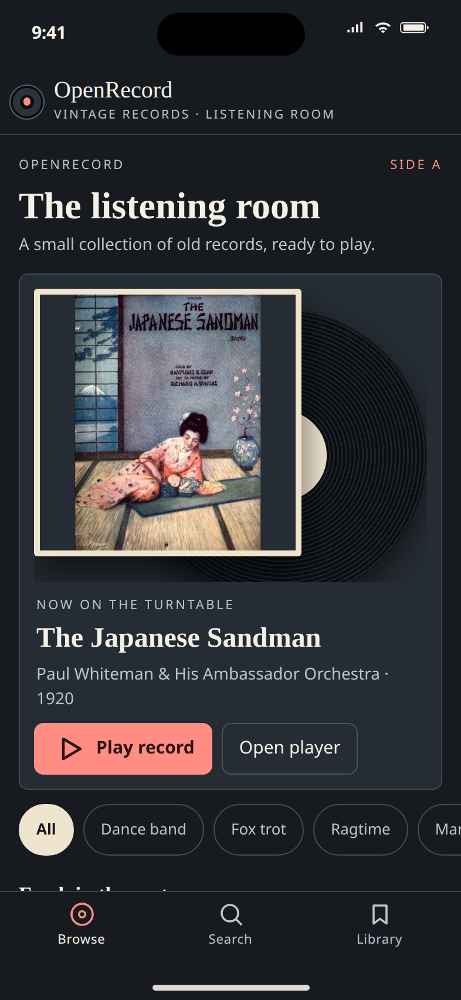
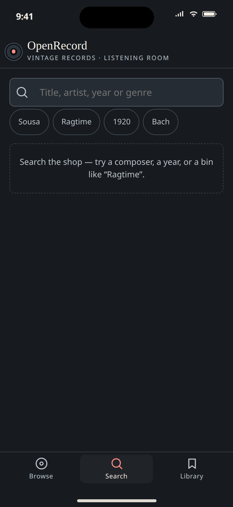
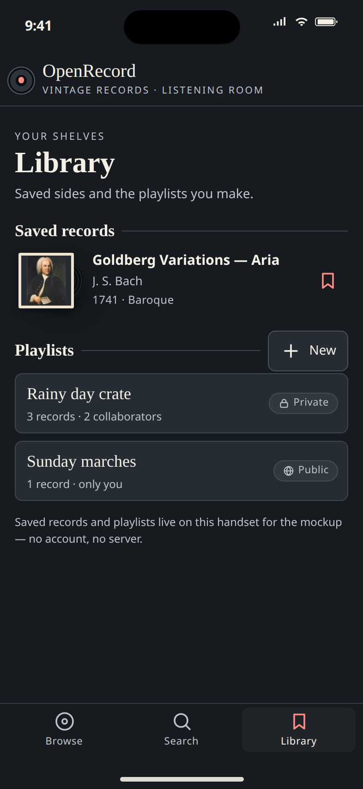
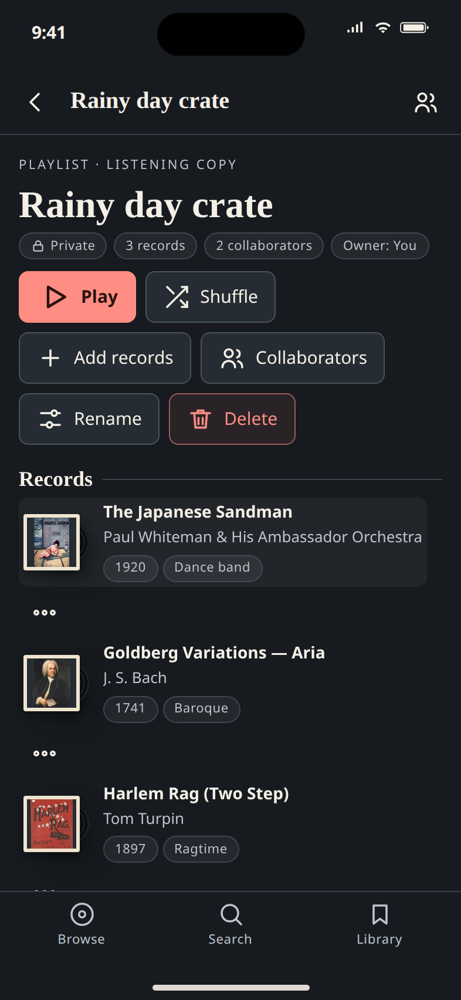
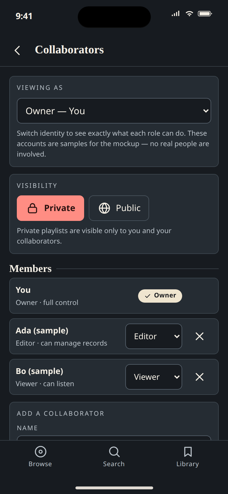
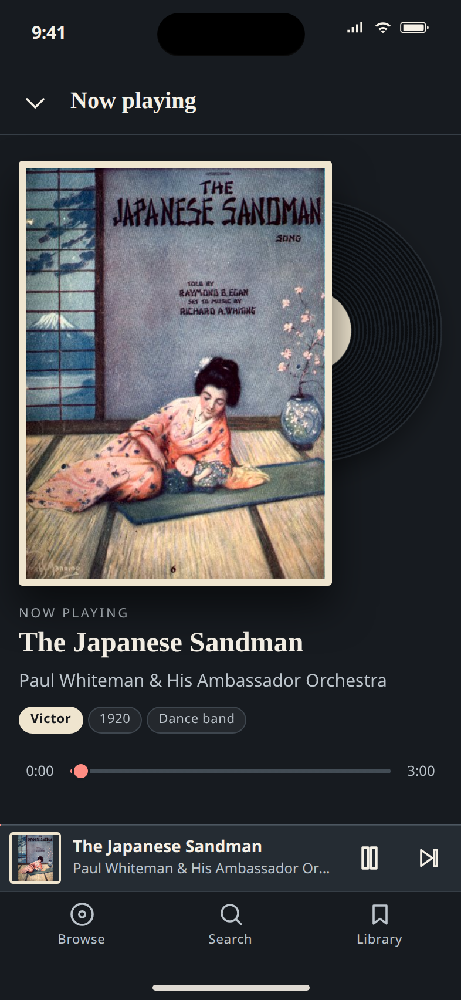

# Open Record

A vinyl record-shop listening room for your phone: browse the crates, build playlists, share them with collaborators, and play it all on a virtual turntable.



> **Notices**
>
> - **AI-built:** this app will be created using AI agents. See [AGENTS.md](AGENTS.md) for the rules they follow.
> - **Design:** the design and mockup were created using the [Open Design](https://github.com/nexu-io/open-design) app. The design system is documented in [DESIGN.md](DESIGN.md).
> - **Music disclaimer:** the author is not responsible for any music that users choose to download, and owns no copyrights to any songs downloaded. Users are solely responsible for ensuring they have the rights to any music they download or use.

## Status

Milestones M0 to M3.8 are implemented: foundations, data and player core, the five screens, local import and offline, Settings, the stream-first downloader server (`apps/server`) and QR scan for the server address. Optional Supabase accounts and Spotify import are also in (see roadmap). The app has three tabs (Browse, Search, Library). On phones a menu button in the top bar opens a drawer with the same content as the desktop sidebar (tabs, playlists, Account, Import and Settings); on desktop Import and Settings sit in the sidebar footer under the Account row. Android Back closes the drawer or an open dialog first, then goes to the previous screen, then to Browse, and on Browse sends the app to the background (uses `@capacitor/app`; run `npx cap sync` after updating). The Collaborators screen is hidden in v1 (role logic is kept in state for v2). Device testing on Android is about to start and is still pending, so none of it is verified on a device. The iOS QR scanner is an in-app scanner and its device test is pending. The interactive mobile mockup is in `mockup/`.

## Roadmap

Plans for v1 (frontend app), v2 (backend) and later are in [roadmap/](roadmap/README.md).

## Features (as shown in the mockup)

- **Browse:** "The listening room" home with a "Now on the turntable" record (spinning disc and sleeve), Play record / Open player buttons, and genre bins (All, Dance band, Fox trot, Ragtime and more).
- **Search:** search by title, artist, year or genre, with quick suggestions such as Sousa, Ragtime, 1920 and Bach.
- **Library:** saved records (bookmark toggle) and your playlists, each marked Private or Public, with a New playlist button. Add Songs from Playlist bookmarks every track of a chosen playlist in one go, in the playlist's order (first track on top); already-saved tracks keep their place.
- **Playlists:** play or shuffle, add records, rename, delete, and see each record's album, source, download state and duration. On desktop the list is a table you can sort by title, album, source, date added or duration.
- **Collaborators (hidden in v1, shown in the mockup and screenshots only):** Private/Public visibility, plus Owner, Editor (can manage records) and Viewer (can listen) roles. A "Viewing as" switch previews what each role can do; members are samples only.
- **Import local files:** on the Import page, choose "Audio files on this device" to add your own audio files (tags and embedded art are read, titles and artists are editable) and play them alongside the bundled records.
- **Import history:** every import (audio files, a Spotify export, or a YouTube playlist or song) is saved as an import session (label, counts and track ids only) and, when signed in, synced to your other devices. Open Import history from the Import page to see each session's date, counts and records, edit or remove imported files, clear all imported files, or delete a session (its records stay). Spotify sessions are deleted with the rest of the Spotify import data, on this device and from your account.
- **Stream and save (optional):** with your own [stream-link server](apps/server/README.md), search YouTube, YouTube Music and SoundCloud, or paste a link (Bandcamp, Audiomack, Mixcloud and other yt-dlp sites). The server only finds a direct link; the app streams it, and the download happens on your device. Tap a result to stream it; bookmarking it or adding it to a playlist saves the file to your device in the background, and removing it from the library and all playlists deletes the file. The app looks up tags and hi-res cover art from iTunes and Deezer itself and saves them with the track. Links are tied to the server's public IP and expire, so streaming and saving work on the same network as the server (e.g. home Wi-Fi), not on a different network such as mobile data. Android and iOS both use the server URL. Setup is one command (`npm run server:up`), phones scan a QR code for the server address, and when the PC has several LAN addresses the script lets you choose the one on your phone's Wi-Fi.
- **Auto-download (untested on device):** a Library switch (off by default) and a per-playlist switch save tracks to the device automatically. They run only on Wi-Fi unless Settings > Allow auto-download on mobile data is on (uses `@capacitor/network`; run `npx cap sync` after updating). While songs download, a progress bar under the switch shows how many are left. On Android, downloads (auto and manual) keep running with the screen off: a foreground service (`BackgroundWorkPlugin.java`, type dataSync) shows a low-importance "Downloading · N left" notification and holds wake and Wi-Fi locks until the queue is idle, paused or stopped (needs a native rebuild; untested on device). Saved tracks always play from the device file, and the player pre-resolves and preloads the next track about 15 s before the current one ends.
- **Fix failed downloads:** auto-download keeps going when individual songs fail (it pauses only for systemic problems such as the server being unreachable). The status line under each auto-download switch shows a live "N couldn't be downloaded" link to the Fix failed downloads page (`/downloads/failed`, also linked from Settings). Each failed song shows its reason and a Fix link dialog: pick a replacement from a remote search (the Spotify import review's suggestions) or paste a YouTube / YouTube Music video link (allow-listed to youtube.com, music.youtube.com and youtu.be on the device before anything is sent). Every candidate is checked first: the server resolves a stream link and the app fetches only its first 1 KB (no full download, no server audio proxying), with the usual link-not-ready retry. If the check fails (private, removed, restricted, live, playlist, unreachable or refused), the reason shows inline and nothing changes. On success the song keeps its title, artist, album, bookmark and playlist places; its id is updated everywhere (library, playlists, queue, downloads, import history and sync) and the download starts at once.
- **Accounts (optional, untested on device):** sign in with email and password through your own [Supabase](https://supabase.com) project (Settings > Account, or the Account page). You can browse without an account; saving tracks, adding downloads to playlists and the Import wizard need you to sign in. See [Supabase setup](#supabase-accounts-optional).
- **Spotify import (optional, untested on device):** the Import page (the sidebar Import row on desktop; on phones, Settings > Import playlists & files) holds the sources. Export a playlist or Liked Songs as CSV with [Exportify](https://exportify.app) and paste its text into the app (or pick the .csv file), or pick the JSON files from your Spotify data download (unzip it first). No Spotify account setup is needed. Matching to YouTube Music runs in the background through your stream-link server, and a review list lets you confirm or fix uncertain matches. See [Spotify import](#spotify-import-optional).
- **YouTube playlist import (optional, untested on device):** in the same Import page, choose "YouTube or YT Music playlist or song" and paste the link of a public or unlisted playlist (`youtube.com`, `music.youtube.com` or `youtu.be`; private playlists are refused with a clear message). A single song link (`youtube.com/watch?v=…`, `music.youtube.com/watch?v=…` or `youtu.be/…`) instead adds just that song to your library, with no playlist made, and is listed in Import history as "YouTube · song title". Your stream-link server reads the playlist's entries (metadata only, first 500) and they become a new playlist named after it, streamable at once and listed in Import history as "YouTube · playlist name". Songs already in your library are reused as they are. It is one import flow on the Import page, with an "Also add to Liked Songs" checkbox. It runs through the same job as Spotify: pending, then a song-detail lookup through the server's `/meta/enrich` (YT Music, iTunes, Deezer and MusicBrainz; no API keys), then an automatic match at high confidence, otherwise review. One "Import progress" panel shows the source, counts (Matched, To review, Not found, Pending) and a single Pause, Resume and Stop, and an Added list shows finished songs. Review rows show metadata suggestions (art, title, artist, album and year, score) with a preview of the song's own link, and the actions Use this, Keep original, Skip, Search again and Paste another link. A confident match replaces the title, artist, album, artwork, year and genre (fields you edited yourself are kept). The original YouTube title and link are always kept. You can pause, resume or stop it, it resumes after a restart, and it never blocks playback. Only the resulting song details are stored and synced; raw catalogue responses are not.
- **Settings:** storage usage, clear data, Audio quality (separate streaming and download quality: Highest by default, High ~160, Medium ~128, Low ~64 kbps; optional "use streaming quality for downloads" switch; untested on device), Allow auto-download on mobile data, Device storage (phone only: auto-download summary, downloaded songs, space used, free space; on Android a Download location choice between app storage and external app storage that applies to new downloads only; needs a native rebuild, untested on device), Stream server (address, test connection, Scan QR code on Android and iOS), and credits.
- **Account:** profile (joined date, age, last sign-in), library and playlist stats, Sync now, change password (asks for the current one; a reset-email link is the only way to set one without it), change email, sign out, sign out of all devices and delete account. Deletion calls a `security definer` SQL function (`supabase/migrations/`), so no `service_role` key is ever used.
- **Filter and long lists:** Library and each playlist have a filter field that matches title, artist and album (every word, ignoring case and accents); Play, Shuffle and row taps use the filtered list, and Move up/down hide while filtering. Long track lists (Library, playlists, import sessions) render 40 rows at first and add more as you scroll.
- **Queue:** Play next (from a playlist row's options or an Up next row) plays before the normal queue; Up next rows also have Remove from queue.
- **Now playing:** full-screen player with sleeve art, label, year and genre tags, seek bar, plus a persistent mini player with pause and next. On desktop the side panel shows art, details and Up next only (transport controls are in the player bar, which also has a save-to-library bookmark).

## Screenshots

| | | |
|---|---|---|
|  |  |  |
| **Browse:** the listening room and genre bins | **Search:** by title, artist, year or genre | **Library:** saved records and playlists |
|  |  |  |
| **Playlist:** play, shuffle, add, rename, delete | **Collaborators:** visibility and roles | **Now playing:** player with seek bar and mini player |

## Run on Android

Prerequisites: Node 24, the Android SDK (Android Studio is not required), a phone with USB debugging on (or an emulator), Docker (for the server), and the phone on the same Wi-Fi as the PC.

1. Install dependencies: `npm install`
2. Start the stream server: `npm run server:up`. It prints one link, `http://<lan-ip>:8787/`, and a QR code. If several LAN addresses exist and it runs in a terminal, it asks which one matches the phone's Wi-Fi; override with `npm run server:up -- --ip 10.0.0.139`. If the `/health` hint says port 8787 is blocked, allow it through the PC firewall.
3. Build and run the app: `npm run android` (builds, runs cap sync, then `cap run android` on the connected device or emulator).
4. In the app, open Settings > Stream server > Scan QR code (or type the server address), tap Test connection, then sign in (Settings > Account). Then use Search > Download sources.

## Supabase accounts (optional)

Accounts use your own Supabase project; the project hosts none. Sign-in also enables [sync between devices](#sync-between-devices).

1. Local: install the [Supabase CLI](https://supabase.com/docs/guides/cli), then run `supabase start` in the repo root (uses `supabase/config.toml` and applies `supabase/migrations`). `supabase status` prints the API URL, anon key and JWT secret. Or create a hosted project at supabase.com and run the migration in `supabase/migrations/` against it.
2. The host sets `SUPABASE_URL` and `SUPABASE_ANON_KEY` once in `apps/server/.env` (anon key only; never the service-role key). The server serves them at the public `GET /app-config`, and the web app and phones fetch them from it, so users never type a Supabase URL or key. On a phone use your PC's LAN address instead of `127.0.0.1`. A build-time `SUPABASE_BUILD_CONFIG` in `apps/app/src/app/supabase.config.ts` (`{ url, anonKey }`) still works.
3. Optional: set `SUPABASE_JWT_SECRET` in the same file for shared-secret (HS256) projects; asymmetric projects are verified through `SUPABASE_URL`. The app sends the signed-in user's Supabase token to the server, which accepts it. See the [server README](apps/server/README.md).

## Spotify import (optional)

No setup is needed. On the Import page, choose a source:

1. **Exportify (CSV):** tap "Open Exportify" (opens [exportify.app](https://exportify.app) in your browser), log in with Spotify and export a playlist or Liked Songs (or Export All). Open the CSV, copy all its text, come back and paste it into the box, then tap "Read pasted CSV". Paste one playlist at a time and give each an optional name (default "Imported playlist N"; "Liked Songs" adds to Liked Songs). You can also pick .csv files instead.
2. **Spotify data download (JSON):** request it under Spotify > Privacy, unzip it, then pick `Playlist1.json` or `YourLibrary.json`.

Then select playlists, follow matching progress and review uncertain matches. After pulling changes that add or remove Capacitor plugins or native config, run `npx cap sync`.

## Use it on a PC

`npm run server:up` also serves the web app at the URL it prints (`http://<lan-ip>:8787/`). Open that link in a browser, create an account or sign in, then use Import and paste or pick your Exportify CSVs there.

## Sync between devices

Sign in with the same Supabase account on both devices (see [Supabase accounts](#supabase-accounts-optional)); the library then syncs on its own, or tap **Sync now** in Settings.

- Syncs: track metadata, saved songs, playlists and import history (labels, counts, track ids). Never audio files or raw Spotify data.
- Conflicts: last write wins.
- Setup: create a Supabase project, apply the SQL in `supabase/migrations/`, set `SUPABASE_URL` and `SUPABASE_ANON_KEY` in `apps/server/.env`, run `npm run server:up`, open the printed link and create an account.
- Not yet tested against a real Supabase project or in a browser.

## Run the server

`npm run server:up` starts the server in Docker (see [Stream-link server](#stream-link-server) below). There is no stop script; stop it with `docker compose -f apps/server/docker-compose.yml down`. A manual Docker alternative is below.

## Repo layout

```
apps/app/            Angular + Capacitor app (android/, ios/)
supabase/           Supabase config and SQL migrations (optional accounts)
apps/server/        Self-hosted stream-link server (Fastify, yt-dlp, Docker)
libs/                Shared libraries (models, state, storage, player, ui, providers, metadata-lookup, features)
mockup/              Interactive HTML mockup (index.html, assets/, ATTRIBUTION.md)
docs/screenshots/    Screenshots of the six screens
roadmap/             Planning docs (v1 frontend, v2 backend, stream-link server, later ideas)
DESIGN.md            Design system
AGENTS.md            Rules for AI agents working on this project
LICENSE              MIT license
```

## View the mockup

Serve the folder, then open the printed address (usually http://localhost:8000):

```bash
cd mockup
python3 -m http.server
```

Or open `mockup/index.html` directly in a browser. Serving is safer for audio playback.

## Sample media

The mockup's sample audio and cover art are openly licensed or public-domain items from Wikimedia Commons. Licences and credits are listed in [mockup/ATTRIBUTION.md](mockup/ATTRIBUTION.md).

## Metadata credits

When you configure the optional stream-link server, the app itself calls (from the device, not through the server) and gets track metadata and cover art from the [iTunes Search API](https://developer.apple.com/library/archive/documentation/AudioVideo/Conceptual/iTunesSearchAPI/) and the [Deezer public API](https://developers.deezer.com/api). Cover art remains the copyright of its rights holders. iTunes' terms limit artwork use to promoting store content and Deezer's API terms are unverified, so treat this as a personal, self-hosted tool. Without a server configured, the app makes no network calls.

## Stream-link server

The optional server in [apps/server](apps/server/README.md) uses yt-dlp to search and to return a direct stream link (`POST /stream`); it never downloads, tags or serves audio itself, and has load safeguards (concurrency cap, queue, `503` with `Retry-After`, rate limits, link cache; see `MAX_CONCURRENT_RESOLVES`, `STREAM_CACHE_TTL`, `RESOLVE_RATE_LIMIT_MAX`). Streaming or downloading may break the source site's terms of service; see the music disclaimer above and keep it out of store builds. Quick start:

```bash
npm run server:up
```

It starts the server in Docker and prints one link, `http://<lan-ip>:8787/`, and a QR code. In the app, open Settings > Stream server and tap "Scan QR code" (Android uses ML Kit, iOS scans in-app) or type the address; only the server address is stored, then sign in. Users sign in with Supabase and the app sends their token; the shared token is not asked for in the UI.

Manual Docker run:

```bash
export OPEN_RECORD_TOKEN=$(openssl rand -hex 32)
docker compose -f apps/server/docker-compose.yml up -d --build
curl http://127.0.0.1:8787/health
```

Expose it over HTTPS (Tailscale or a Cloudflare tunnel), or on a trusted home network publish it on your LAN with `BIND_ADDRESS=<lan-ip>` and use `http://<lan-ip>:8787` (unencrypted: tokens are visible to others on the network; see the [server README](apps/server/README.md#plain-http-on-your-home-lan)). Then enter the address in the app under Settings, Stream server (or scan the QR code). More in [roadmap/downloader-server.md](roadmap/downloader-server.md).

## License

Released under the [MIT License](LICENSE). Copyright (c) 2026 Ahnaf. Sample media keep their own licences (see above).
