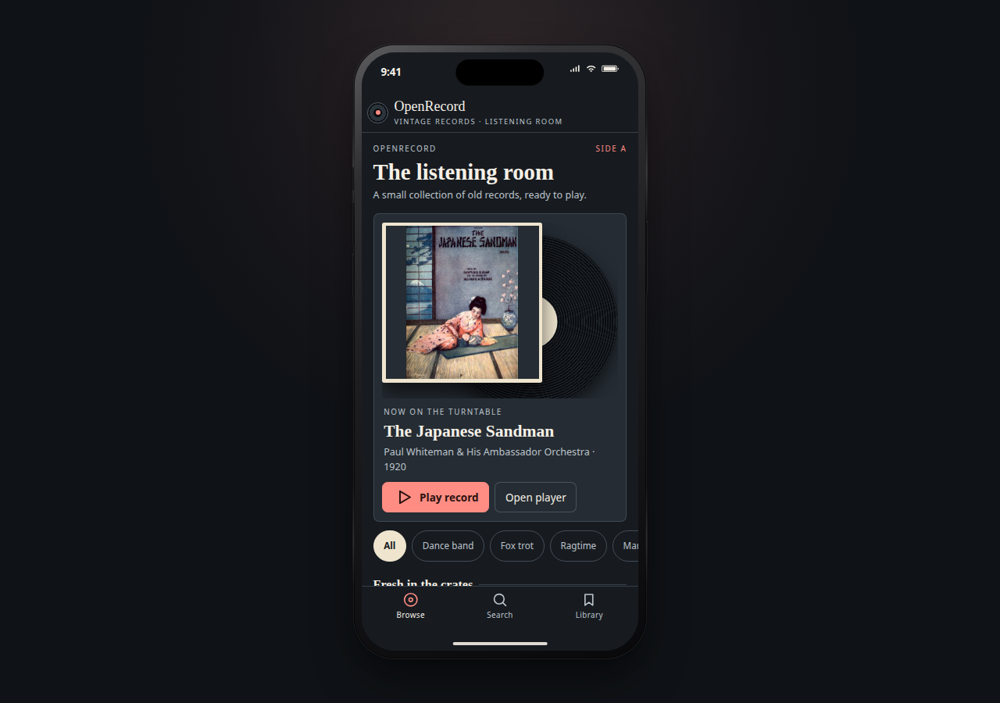
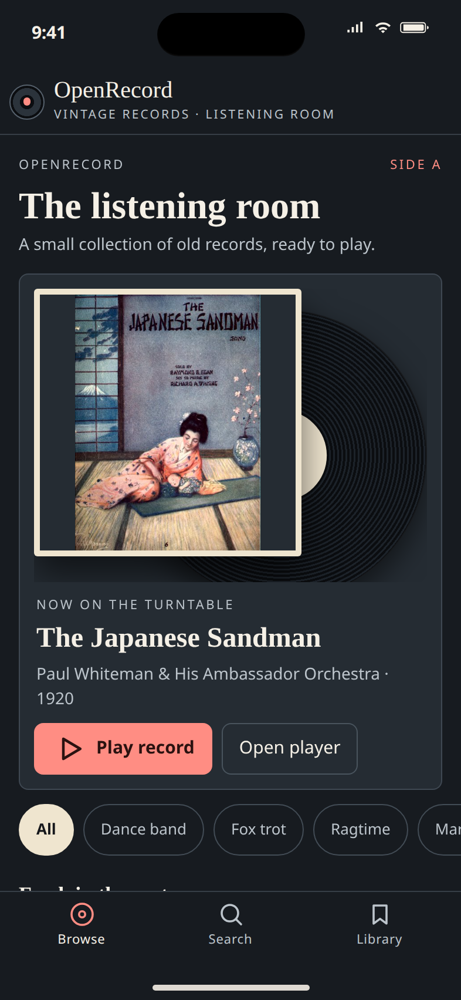
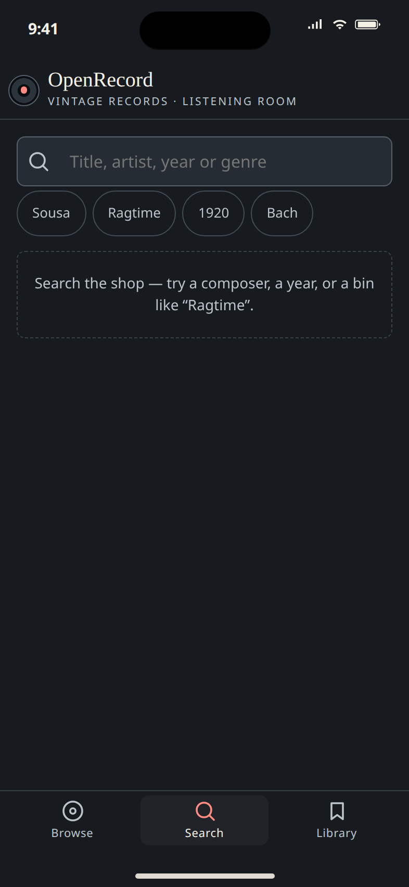
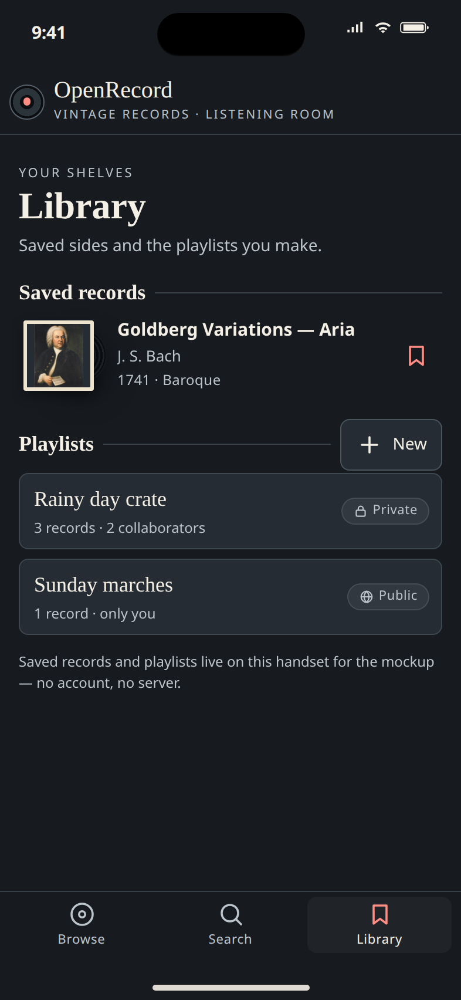
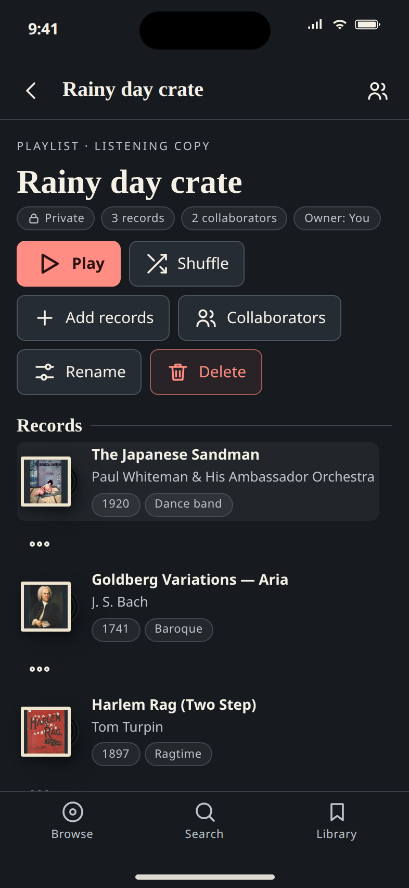
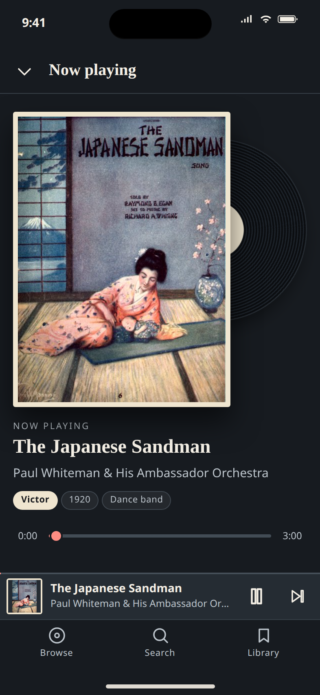
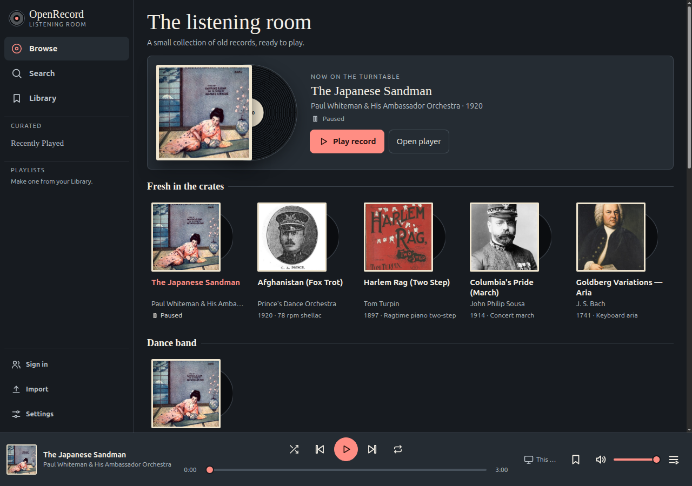

# Open Record

A vinyl record-shop listening room for your phone and desktop: browse the crates, build playlists,
import your own music, and play it all on a virtual turntable. **Version 1.0.0.**



## Download

| Platform | File | Notes |
|---|---|---|
| Linux x64 (recommended) | [OpenRecord-linux-amd64.deb](https://github.com/ahnafone/open-record/releases/latest/download/OpenRecord-linux-amd64.deb) | `sudo apt install ./OpenRecord-linux-amd64.deb` |
| Linux x64 | [OpenRecord-linux-x86_64.AppImage](https://github.com/ahnafone/open-record/releases/latest/download/OpenRecord-linux-x86_64.AppImage) | `chmod +x`, then run |
| Windows x64 | [OpenRecord-windows-x64.exe](https://github.com/ahnafone/open-record/releases/latest/download/OpenRecord-windows-x64.exe) | SmartScreen warning; More info > Run anyway |
| macOS Apple Silicon | [OpenRecord-macos-arm64.dmg](https://github.com/ahnafone/open-record/releases/latest/download/OpenRecord-macos-arm64.dmg) | Open the DMG, drag to Applications |
| macOS Intel | [OpenRecord-macos-x64.dmg](https://github.com/ahnafone/open-record/releases/latest/download/OpenRecord-macos-x64.dmg) | Same, with the Intel DMG |
| Android | [OpenRecord-android.apk](https://github.com/ahnafone/open-record/releases/latest/download/OpenRecord-android.apk) | Android 7+; see [release builds](#release-builds) |
| iPhone / iPad | [Build with Xcode](#run-on-iphone) | Free Apple ID; re-sign every 7 days |

Desktop builds are unsigned. The links point at the latest release; the desktop workflow uploads
installers on a `v*` tag. A missing file means that asset is not published yet. There is no App
Store, TestFlight, Play Store or enterprise build.

> **Notices**
>
> - **AI-built:** this app was built with AI agents. See [AGENTS.md](AGENTS.md) for the rules they follow.
> - **Design:** the design and mockup were created with the [Open Design](https://github.com/nexu-io/open-design) app. The design system is in [DESIGN.md](DESIGN.md).
> - **Music disclaimer:** the author owns no copyrights to any music users download and is not responsible for what they choose to download. You are solely responsible for having the rights to any music you download, stream or use.

## Status

Open Record 1.0.0 is the v1 source tree: an Angular + Capacitor app (Android, iOS and web) with a
bundled public-domain catalogue, local imports, playlists, a queue, background downloads and
optional accounts and sync. The Electron desktop app bundles the UI and local server, and
`.github/workflows/desktop-build.yml` builds the desktop installers.

Collaborators is hidden in v1; its role logic is kept for v2. Android and iOS device testing is
still pending. A signed Android APK is attached to the v1.0.0 release; building your own release
needs your own keystore. The iPhone install uses a free Apple ID in Xcode and expires after 7 days.

## Install and run

Prerequisites: **Node 24** and npm. Android builds need the Android SDK; iPhone builds need a Mac
with Xcode; streaming through your own server needs `yt-dlp` (`pipx install yt-dlp`). `ffmpeg` is
optional for Cast transcoding. For the desktop app, see [docs/desktop.md](docs/desktop.md).

```bash
git clone https://github.com/ahnafone/open-record.git
cd open-record
npm ci
```

Run the web UI in development (no API or stream server):

```bash
npm start
```

Or build and serve the web app with the local server:

```bash
npm run server:up          # builds app + server, starts detached, prints URL and QR
npm run server:up -- --stop
```

`server:up` prints `http://<lan-ip>:8787/` and a pairing QR code. Open it, or enter the address in
the phone app under **Settings > Stream server**. `npm run server:dev` runs it in the foreground.

### Android

```bash
npm run android            # cap sync, then run on a device or emulator
npm run android:release    # signed release APK (needs keystore.properties)
npm run android:release:install
```

Release builds need `apps/app/android/keystore.properties` and your own keystore outside the repo;
see [RELEASE_SIGNING.md](apps/app/android/RELEASE_SIGNING.md). For a local performance build only,
`./gradlew assembleRelease -PallowDebugSigning` in `apps/app/android` signs with the debug key. The
v1.0.0 release includes a signed APK; uninstall a debug-signed build before switching signatures.

### Run on iPhone

1. On a Mac with Xcode, run `npm ci` and `npm run ios:open` to sync the web build and open the
   project.
2. Select the **App** target > **Signing & Capabilities**, choose your Personal Team (a free Apple
   ID), and use a unique bundle ID if `app.openrecord` is taken.
3. Connect an iPhone (iOS 18+), enable Developer Mode if asked, select it and press Run.
4. Trust the developer in **Settings > General > VPN & Device Management**. Free-account builds
   expire after **7 days**; re-run from Xcode to re-sign. This is not TestFlight or the App Store.

`npm run ios` uses the Capacitor CLI; `npm run ios:release` makes a generic Release build that is not
directly installable. Use Xcode Run for a device.

## Desktop app

The desktop app wraps the Angular UI, the local Fastify server, `yt-dlp` and `ffmpeg` in one
Electron application.

- **Offline:** bundled catalogue, local imports, playback, playlists, history and settings. Remote
  search/stream/save, metadata and Supabase need internet; phones need the same LAN.
- **Fixed origin:** `http://127.0.0.1:47900`. Storage is tied to the origin, so a taken port reports
  an error instead of silently changing it.
- **Setup page:** **Settings > Desktop app** (or `http://127.0.0.1:47900/desktop`) saves your
  Supabase project URL and anon key. It refuses `service_role` and `sb_secret_...` keys.
- **Phones on this network:** the toggle restarts the local server on all interfaces and shows the
  LAN address and QR code. Use a trusted Wi-Fi only (plain HTTP), and never port-forward 47900.
- **Unsigned, no auto-update:** expect Gatekeeper/SmartScreen warnings; reinstall to update. The
  data folder and fixed origin preserve your library.

See [docs/desktop.md](docs/desktop.md) for install, data folders, Supabase and troubleshooting.
Build the app for the current OS with `npm run desktop:dist`; `npm run desktop:dev` runs the
Electron shell against the local build.

## Deploy over HTTPS

Full DNS, router, firewall, Caddy and Supabase runbook: [deploy/README.md](deploy/README.md).
The reference deployment uses `https://open-record.uttarasoftware.ca`: a DNS A record points it at
the public address, and the router forwards **TCP 80 and 443 only**. Caddy on the LAN host
(`10.0.0.139`) terminates TLS with a Let's Encrypt certificate and proxies to `127.0.0.1:8787`.

`10.0.0.139:8787` is the home-Wi-Fi address, **not** the public URL. Keep 8787 firewalled to the LAN
and never expose it directly. Verify `/health`, `/app-config`, the 401/200 `/ping` pair, and that
8787 is closed from outside.

## Website

A static landing page is planned for GitHub Pages at <https://ahnafone.github.io/open-record/>. When
published it will be served from [docs/](docs/) with the same downloads, screenshots and install
links. The page is not live yet; until then this README and [docs/desktop.md](docs/desktop.md) are the docs.

## Features

- **Browse:** a "Now on the turntable" record with a spinning disc and sleeve, Play record and Open
  player buttons, and record-shop genre bins (All, Dance band, Fox trot, Ragtime and more).
- **Search:** by title, artist, year or genre, with quick suggestions. With a stream server, search
  YouTube, YouTube Music and SoundCloud, or paste a link from a yt-dlp site.
- **Library:** saved records with a bookmark toggle, plus playlists marked Private or Public. Filter
  by title, artist and album; long lists render as you scroll; on desktop the list is a sortable table.
- **Playlists:** play or shuffle, add records, rename, delete, and reorder. Each row shows its source,
  download state and duration.
- **Now playing and queue:** full-screen player with sleeve art, seek bar and track details, a
  persistent mini player, Play next and an editable Up next list. Desktop has a resizable side panel,
  keyboard shortcuts and media-key support.
- **Imports:** audio files from the device with editable tags and art; Spotify Exportify CSV or JSON
  from a data download; YouTube / YT Music playlist or song links. Matching runs through your server,
  and uncertain matches wait in a review list. Every import becomes an Import history session.
- **Stream and save:** with your own [stream-link server](apps/server/README.md), the app streams a
  direct link and saves the file on your device. It looks up tags and hi-res cover art from iTunes and
  Deezer. Links are tied to the server's public IP and expire, so streaming and saving work on the
  same network as the server, not on mobile data.
- **Auto-download and recovery:** a Library switch and per-playlist switches save tracks
  automatically, on Wi-Fi by default (mobile data is opt-in). On Android a foreground service keeps
  downloads running with the screen off. Failed songs show a reason, Retry and a Fix link page at
  `/downloads/failed`.
- **Accounts, sync and Cast (optional):** your own Supabase project adds email/password sign-in and
  syncs track metadata, saved songs, playlists and import history, never audio. Conflicts are
  last-write-wins. Signing in also shares the playback queue, and Google Cast speakers on the LAN
  appear in the **Play on** picker.
- **Settings:** storage usage, clear data, separate streaming and download quality, mobile data
  permission, device storage, stream-server address with QR scan, and credits.

## Screenshots

| | |
|---|---|
|  |  |
| **Browse:** the listening room and genre bins | **Search:** by title, artist, year or genre |
|  |  |
| **Library:** saved records and playlists | **Playlist:** play, shuffle, add, rename, delete |



**Now playing:** full-screen player with seek bar, queue and mini player.



**Desktop:** the same library and player in the Electron app, with the local server bundled.

## Release builds

Build and measure with release builds, not debug.

- **Desktop:** `.github/workflows/desktop-build.yml` builds the Linux `.deb`/AppImage, Windows NSIS
  installer and both macOS DMGs on a `v*` tag, writes `SHA256SUMS.txt`, and uploads them to the
  GitHub release. All desktop installers are unsigned; there is no auto-update.
- **Android:** `npm run android:release` builds the signed APK when `keystore.properties` is
  configured (keystore outside the repo); `android:release:install` installs it. Debug signing is
  opt-in with `-PallowDebugSigning` for local performance builds. The v1.0.0 release includes the
  signed `OpenRecord-android.apk`.
- **iPhone:** run the **Release** configuration from Xcode with a Personal Team to install on a
  device; `npm run ios:release` only makes a generic build. No TestFlight; free-account builds expire after 7 days.
- **Checks:** `npm run check` runs token checks, lint, typecheck and build.

## Supabase accounts (optional)

Accounts, sync, Cast and phone sign-in use a Supabase project you create and own; Open Record hosts
no accounts, audio or relay.

1. Create a project at [supabase.com](https://supabase.com), or run `supabase start` locally. Apply
   `supabase/migrations/` in filename order (`npx supabase db push` or the SQL Editor).
2. Enable **Email** auth with a minimum password length of 6, create the owner account, then close
   sign-ups and anonymous sign-ins. Every public table needs row-level security, with no policy for
   the `anon` role.
3. Web/server: set `SUPABASE_URL` and `SUPABASE_ANON_KEY` in `apps/server/.env` and restart
   `npm run server:up`. The app reads them from `GET /app-config`.
4. Desktop: save the same values under **Settings > Desktop app** (`/desktop`).

Use the anon key only; never put a `service_role` or `sb_secret_...` key in the server, the desktop
config or a build. Sync covers metadata, saved songs, playlists and import history, never audio;
conflicts are last-write-wins.

## Stream-link server

[apps/server](apps/server/README.md) is a small self-hosted Fastify + `yt-dlp` server. It finds a
direct audio link and returns it; the phone fetches the audio. It never downloads, tags or proxies
audio, except the Cast relay to a Google Cast speaker.

```bash
npm run server:up
```

It needs Node 24 and `yt-dlp` on the host. The generated token lives in `~/.config/open-record/` with
mode 0600, and the command prints the URL and QR code. The server has a concurrency cap, wait queue,
rate limits and a link cache, and returns `503` with `Retry-After` when busy.

Use plain HTTP only on a trusted home LAN; the bearer token is unencrypted. Outside the home, put the
server behind HTTPS (Tailscale or a Cloudflare tunnel) and set `TRUST_PROXY` and `PUBLIC_URL`. See the
[server README](apps/server/README.md#https-recommended-required-outside-your-home). Never
port-forward 8787.

## Repo layout

```
apps/app/              Angular + Capacitor app (android/, ios/)
apps/desktop/          Electron app, installer config and server-package-lock.json
apps/server/           Self-hosted Fastify + yt-dlp stream-link server
deploy/                Caddy/systemd deployment runbook and unit
docs/                  Screenshots and the planned Pages landing page
docs/desktop.md        Desktop install, Supabase and LAN phone guide
supabase/              Supabase config and SQL migrations (optional accounts)
libs/                  Shared models, state, storage, player, UI and feature libraries
mockup/                Interactive HTML design mockup (index.html, assets/)
.github/workflows/     Desktop installer CI
DESIGN.md              Design system
AGENTS.md              Rules for AI agents working on this project
LICENSE                MIT license
```

## Mockup and sample media

The interactive design mockup is in [`mockup/`](mockup/index.html); serve it with
`cd mockup && python3 -m http.server` and open <http://localhost:8000>. Sample audio and cover art
are openly licensed/public-domain Wikimedia Commons items; credits: [mockup/ATTRIBUTION.md](mockup/ATTRIBUTION.md).

## Metadata credits

With a stream server configured, the app calls the [iTunes Search API](https://performance-partners.apple.com/search-api)
and the [Deezer public API](https://developers.deezer.com/api) directly from the device for tags and
cover art. Cover art remains the copyright of its rights holders. iTunes' terms limit artwork use to
promoting store content, and Deezer's API terms are unverified, so treat this as a personal,
self-hosted tool. Without a server configured, the app makes no network calls.

## License

Released under the [MIT License](LICENSE). Copyright (c) 2026 Ahnaf. Sample media keep their own
licences (see [mockup/ATTRIBUTION.md](mockup/ATTRIBUTION.md)).
